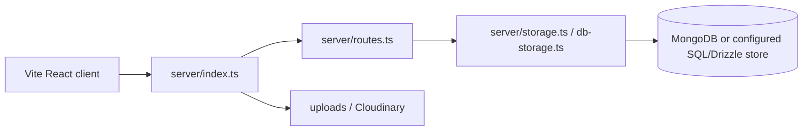

# Prayog

A full-stack TypeScript/React application for rental and machine-part workflows. The repository includes the primary `client/` and `server/` app plus experimental/simple-renthub variants and extensive product/deployment notes.

## Architecture



The server registers API routes, connects/seeds MongoDB, serves attached assets, and switches between Vite middleware in development and built static assets in production. Shared types/schema live under `shared/`.

## Setup

```bash
npm ci
npm run dev
# type-check and production build
npm run check
npm run build
npm start
```

Configure database, session, Cloudinary, and AI/provider variables in a local environment. `npm run db:push` applies the Drizzle schema where the configured database supports it; review changes before running against shared data.

## Data/API workflow

The browser calls `/api/*` routes registered by `server/routes.ts`. Request logging records method, path, status, and duration. Storage abstractions keep route code separate from persistence; seed logic initializes development data.

## Deployment

Build with Vite/esbuild and run `node dist/index.js` on a Node.js host. The included notes cover Render deployment. Use HTTPS, a production session store, strict CORS, persistent media storage, and least-privilege database credentials.

## Testing and limitations

`npm run check` is the available static validation; no comprehensive test suite is declared. Exercise authentication, rentals, admin flows, seed/idempotency behavior, uploads, and database outages. Experimental subprojects may not share the production data model.

## Security and operations

- Keep credentials, database URLs, OAuth tokens, API keys, and signing secrets in environment variables; never commit them.
- Validate and constrain uploaded files and user input at the server boundary, and enable HTTPS in production.
- Review dependency updates and rotate any credential that has appeared in repository history.

## Testing

The repository currently has no comprehensive automated test suite unless noted above. Before production changes, add tests for authentication/authorization, validation failures, persistence errors, and the primary user workflow.

## Limitations and roadmap

This is an actively evolving project. Production hardening, observability, rate limiting, backup/retention policy, and accessibility/performance validation should be completed before handling sensitive or high-volume workloads.

## License

See the repository license file and package metadata for the authoritative terms.
## Implementation notes

The primary app is a Vite/React client with an Express/TypeScript server. `server/routes.ts` implements authentication, role-gated industry/user workflows, rentals, machine parts, exchanges, appraisals, health reports, cart/checkout, tracking, notifications, admin seed/QR operations, and AI-assisted analysis. `shared/schema.ts` and `shared/constants.ts` define shared contracts; storage adapters support MongoDB and Drizzle/Postgres paths.

### API and operations

Representative routes include `/api/login` or `/api/auth/*`, `/api/items`, `/api/rentals`, `/api/machine-parts`, `/api/exchanges`, `/api/cart`, `/api/tracking`, `/api/ai/appraisal`, and `/api/ai/health-report`. Run `npm run check`, `npm run build`, and `npm run db:push` only after reviewing schema changes. Configure database, session, Cloudinary, OpenAI/OpenRouter, and mapping credentials through the deployment secret store.

### Security and limitations

Require strong session secrets, role/ownership checks, upload validation, rate limits on AI and tracking endpoints, HTTPS, and durable production session storage. The repository also contains experimental `renthub-simple` and `simple-renthub` variants; do not assume they share the primary app's schema or security guarantees.

### License status

`package.json` declares MIT; retain that notice when redistributing the project and verify third-party asset/model terms separately.
